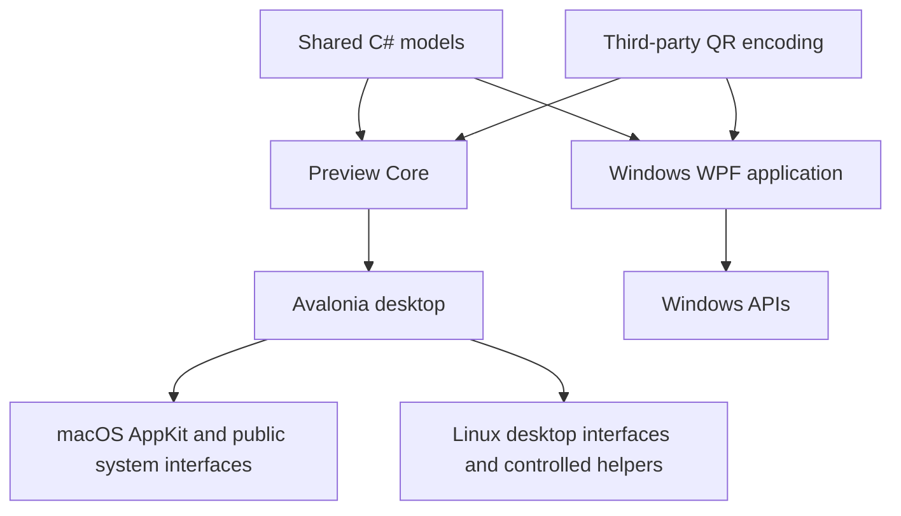

# Architecture

[English overview](../README.md) · [中文说明](../README.zh-CN.md) · [Build and test](BUILDING.md)

Side Island v1.0.0 contains two desktop implementations. The Windows application is the mature product with 38 tools. The macOS/Ubuntu application is an independent preview with 21 tool entries. Sharing business logic does not make their desktop integrations equivalent.

## Source layout

| Directory | Responsibility |
| --- | --- |
| `src/` | Windows WPF shell, tool panels, persistence and native integrations |
| `src/Shared/` | Shared C# business models consumed by both implementations |
| `src/ThirdParty/QrCodeGenerator/` | Attributed QR encoding sources; see the root third-party notices |
| `tests/` | Windows model, WPF, interaction, layout and regression suites |
| `cross-platform/SideIsland.Core/` | Preview models, preferences, Codex adapter, notifications and batch-file logic; links shared sources |
| `cross-platform/SideIsland.Desktop/` | Avalonia shell, tool views and platform adapters |
| `cross-platform/SideIsland.Tests/` | Portable-model, adapter, synthetic integration and headless UI tests |
| `packaging/` | Windows notification identity, MSIX tools and branding |
| `cross-platform/packaging/` | macOS app metadata and Linux launch integration |
| `tools/` | Development, validation and diagnosis helpers; `tools/common/` contains reusable public probes |
| `docs/` | User/developer guidance and historical development notes |
| `assets/` | Product icons and source assets |

The root `VERSION` is the release version source. The v1.0.0 release groups the mature Windows app and explicitly labelled platform previews. Older development numbering in archived notes does not identify another current public release.

## Windows application

The Windows shell uses C# and WPF on .NET Framework 4.8. The build script invokes the framework compiler directly; it is not a modern SDK-style project. Window interaction, docking, animation and compact widgets are separate from the tool models and panels. Theme and localization helpers update the UI without translating user content.

Windows integrations include the user-consented notification listener, system media sessions, Core Audio, screenshot/OCR facilities, clipboard history, global hotkeys and system/process information. Notification access needs a registered package identity as well as user permission. Running the portable executable is sufficient for independent tools, but does not grant notification access.

Settings and tool data use the current user's local application-data directory. Some items are intentionally transient; explicitly saved notes, favorites, tasks and settings are local plaintext. The [archived Windows guide](windows-guide.zh-CN.md) lists the per-feature storage behavior.

## Preview application

The preview uses Avalonia 12.1.4 and .NET 10. `SideIsland.Core` contains platform-independent behavior and explicit shared-source references. `SideIsland.Desktop` owns the window, views and adapters; native failures are surfaced as unavailable/error states rather than fabricated successful results.

The preview has its own application identity and data directories. It does not replace an installed Windows notification app or automatically migrate its data. Defaults are:

- macOS: `~/Library/Application Support/SideIsland`.
- Linux: `${XDG_CONFIG_HOME:-~/.config}/side-island`.
- Windows preview testing: `%LOCALAPPDATA%\SideIsland.PortablePreview`.

`SIDE_ISLAND_DATA_DIR` can select an explicit preview data directory. The original Windows implementation uses `CODEX_ISLAND_DATA_DIR`; these are separate settings.

### Platform adapters

| Adapter | macOS | Linux |
| --- | --- | --- |
| `MacNotchBridge` | Public AppKit screen geometry and native window placement; notch-first policy | Not used |
| `CommandPlatformService` | Explicit Apple Music Apple Events, system volume, `lsof`, owned `caffeinate` process | MPRIS through `playerctl`, system volume through `pactl`, `ss` and `/proc`, owned `systemd-inhibit` process |
| `NotificationBridge` | Explicitly enabled, manually authorized Accessibility reads of recognizable visible Notification Center cards | Explicitly enabled monitoring of permitted session-bus `Notify` calls |
| `ScreenCaptureService` | System region selection | Screenshot Portal, with installed screenshot-tool fallback only when the portal interface is unavailable |

The notification bridge also offers an optional authenticated loopback HTTP feed. It is a transport for an explicitly configured local source, not universal OS notification permission. No GNOME extension is installed by the app.

Helper processes use controlled argument lists rather than shell command strings. They have bounded output and cancellation/timeout handling, and the app only stops processes it owns. These properties do not bypass desktop permission, compositor, bus-policy or filesystem restrictions.

The Mac island surrounds the real notch with drawable content in its visible wings or below. The physical camera cutout has no pixels. Fullscreen Spaces, multi-monitor Retina placement and target OS permission behavior still require native-device validation. Linux positioning currently targets X11/XWayland; the preview does not provide a native Wayland layer-shell implementation.

## Data and external connections

- Quota monitoring uses the local signed-in Codex app-server protocol and reads rate-limit information. It does not start model inference to calculate the displayed quota.
- Online lyrics are optional and off by default; enabling the Windows feature sends track metadata to LRCLIB. Local LRC import remains available independently.
- Notification capture is explicitly enabled. Preview message-history persistence is off by default and, when selected, uses local plaintext storage. Application blocking and priority rules remain local.
- Clipboard recording, local task inputs and LAN sharing have separate controls; they are not implicit global collection services.
- Batch renaming uses preview/conflict checks, native file identities, operation journals and guarded same-session undo. Its concurrency and target-filesystem limits are documented separately.

See [notifications](../cross-platform/docs/NOTIFICATIONS.md), [screenshot pinning](../cross-platform/docs/SCREEN-PIN.md) and [batch files](../cross-platform/docs/BATCH-FILES.md) for implementation boundaries.

## Validation and distribution boundaries

The Windows suite runs WPF-heavy groups in separate STA worker processes. The preview suite combines shared models, parser fixtures, generated localhost integration requests and actual Avalonia headless rendering. Both record failures; rerunning successfully does not explain an earlier failure.

Windows has prior 87-suite regression history and real desktop/media testing. A v1.0.0 source reorganization or new package does not, by itself, establish that another complete 87-suite run occurred. Published validation summaries must describe the checks actually performed for that artifact.

Native macOS and Ubuntu execution has not been verified. Cross-publishing, archive hashes, parser fixtures and a headless DPI matrix do not establish native launch, permission, window-manager or hardware compatibility. Mac previews are not Developer ID signed or notarized.

The repository contains source, build definitions, documentation and third-party notices. Generated binaries, SDK/NuGet caches, local application data, raw logs, crash dumps and private screenshots stay outside tracked source. Distribution ZIPs and checksums are attached to GitHub Releases. Sanitized test summaries may be included in `docs/` without personal paths or captured user content.
